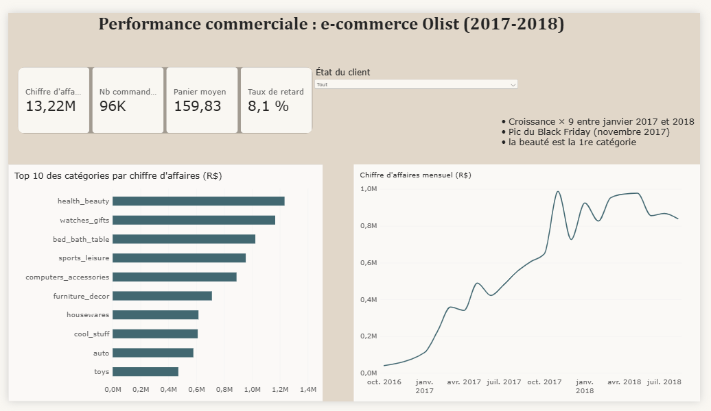

# Analyse de la performance commerciale et clients — E-commerce Olist

**SQL · Python (pandas) · Power BI** — Projet personnel, 2026

Analyse de bout en bout de près de **100 000 commandes réelles** d'une plateforme e-commerce brésilienne (Olist, 2016-2018) : de la base de données SQL jusqu'au dashboard Power BI et aux recommandations business.

---

## Résultats clés

| | Constat | Chiffre |
|---|---|---|
| 1 | **Les retards de livraison détruisent la satisfaction** | Note moyenne **2,57/5** en retard contre **4,29/5** à l'heure ; **54 %** de mauvaises notes (1-2★) contre 9 % |
| 2 | **La fidélisation est quasi inexistante** | **97 %** des clients n'ont commandé qu'une seule fois |
| 3 | **Forte croissance, portée par quelques catégories** | Commandes mensuelles ×9 entre janv. 2017 et 2018 ; pic du Black Friday (nov. 2017) ; la beauté (`health_beauty`) est la 1re catégorie |

**Chiffres globaux** (commandes livrées) : 13,2 M R$ de chiffre d'affaires · 96 000 commandes · panier moyen 160 R$ · 8,1 % de livraisons en retard.

## Recommandations

1. **Réduire les retards de livraison**, en priorité dans le Nord-Est (jusqu'à 24 % de retard en Alagoas), ou annoncer des dates de livraison plus réalistes.
2. **Relancer les ~21 600 clients « à risque »** : gros paniers (≈ 265 R$) mais aucun achat depuis un an.
3. **Lancer un programme de fidélité** pour transformer les nouveaux clients à fort potentiel en clients récurrents.

---

## Démarche

| Étape | Fichier | Contenu |
|---|---|---|
| 1. Base de données | `01_chargement.py` | Chargement des 9 fichiers CSV dans une base **SQLite** (1,5 M de lignes) |
| 2. Analyse SQL | `02_analyses.sql` | 7 requêtes : CA mensuel, top catégories, panier moyen, paiements, délais par État, impact des retards sur les notes, top vendeurs (jointures, sous-requêtes, `CASE WHEN`) |
| 3. Qualité des données | `03_qualite.py` | Valeurs manquantes et 9 contrôles de cohérence (commandes sans article, doublons, mois incomplets, avis multiples…) avec décision pour chacun |
| 4. Segmentation clients | `04_rfm_exports.py` | Segmentation **RFM** (Récence, Fréquence, Montant) en 6 segments + export des tables pour Power BI |
| 5. Dashboard | `dashboard/` | Rapport **Power BI** en 2 pages : modèle relationnel, mesures DAX, filtre par État |

**Points d'attention méthodologiques**
- Les mois incomplets (début 2016, fin 2018) sont exclus des tendances.
- Toutes les valeurs manquantes ne sont pas des erreurs : les dates de livraison absentes correspondent surtout à des commandes annulées.
- Le lien retard → mauvaise note est une **corrélation** : d'autres facteurs (produit, région) peuvent jouer.

## Reproduire le projet

1. Télécharger le dataset [Brazilian E-Commerce Public Dataset by Olist](https://www.kaggle.com/datasets/olistbr/brazilian-ecommerce) et placer les CSV dans `data/`.
2. `pip install pandas`
3. `python 01_chargement.py` puis `python 03_qualite.py` et `python 04_rfm_exports.py`
4. Exécuter les requêtes de `02_analyses.sql` sur `olist.db`.
5. Ouvrir `dashboard/dashboard_olist.pbix` dans Power BI Desktop.

*Montants en réals brésiliens (R$). Données : Olist, licence CC BY-NC-SA 4.0.*

---
**Nermin Assal** — Étudiante en M1 CMI Data Science, Université Paris Nanterre
